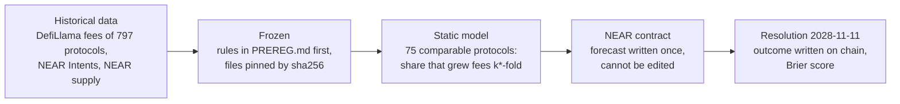
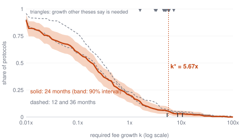
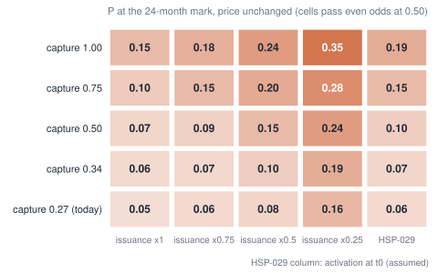

# near-posterior: NEAR Buyback Coverage Forecast

[](https://github.com/Sorghobrayan-dotcom/near-posterior/actions/workflows/check.yml)

An investment thesis for NEAR HACKATHON (track `thesis`) on one question: **will NEAR buybacks
funded by NEAR Intents revenue cover NEAR's net issuance at the 24-month mark?** Not financial
advice.

## In 30 seconds

<!-- BEGIN GENERATED brief -->
- **The question:** NEAR spends part of the NEAR Intents fees on buying back NEAR. Within 24 months, will these buybacks absorb all the new NEAR that the protocol issues?
- **Today:** they absorb 18.5% of it (dollar value, last 90 days to 2026-11-12).
- **The bar:** to absorb all of it, NEAR Intents fees must grow 5.67x in 24 months, from $77.5M to $439.2M a year, with price, issuance and the share of fees spent on buybacks unchanged.
- **The odds:** 5.3%, about 1 chance in 19: the share of 75 DeFi protocols that once had NEAR Intents' size and age and then grew that much in 24 months. Replayed on 201 past 24-month forecasts, this method was too optimistic (fee doubling forecast 25.3%, seen 3.1%), so the real odds are more likely lower than higher.
- **For an investor:** On base rates the buyback does not offset dilution by the 24-month mark: net supply growth stays the base case. A case for NEAR should not rest on buybacks creating scarcity within this horizon.
- **What could change it:** governance, more than market growth: all fees to buybacks 15.2%, issuance cut to a quarter 15.9%, both 34.8%; the best cell of the lever table is 49.1%, so none reaches even odds.
- **What would prove this wrong:** annualised NEAR Intents fees above $439.2M at today's price and issuance. `history.csv` records the odds at every daily snapshot.
- **Locked in advance:** the forecasts are written on NEAR (contract `brayan-posterior.testnet`), cannot be edited, and resolve on 2028-11-11; one command rebuilds every number from the committed data.
<!-- END GENERATED brief -->

## How it works



## What makes it different

- **Outside view, not a trend line.** The odds come from what comparable protocols actually
  did, not from extrapolating NEAR Intents' recent growth.
- **It scores the other theses too.** Every growth multiple stated in a public NEAR thesis is
  placed on the same base rate (`results/forward_claims.csv`, first table of the page). Type
  any multiple in the page, or run `python -m near_posterior.ask --k K`, to score your own.
- **Rules before data.** `PREREG.md` was committed before the reference data was downloaded.
- **Something to check before 2028.** `results/milestones.json` gives the coverage needed at
  each quarter to be on the line to the target; the daily refresh says ahead or behind.
- **The chain is a data source too.** NEAR supply is read from block headers on an archival
  RPC node and compared with the explorer figure (`results/rpc_supply.json`).
- **Tested on the past.** Replayed on 1,659 past forecasts; it beats trend extrapolation, and
  the README says where it was still too optimistic.
- **On NEAR, cannot be edited.** The forecasts sit in our own contract until they resolve.
- **One command rebuilds every number**, checked by CI on Linux, Windows and macOS.
- **Live page**: `site/index.html` has a simulator (share of fees spent on buybacks, issuance,
  price, horizon) that recomputes the odds as you move the sliders.

## In detail

<!-- BEGIN GENERATED finding -->
**Finding:** on the snapshot of 2026-11-12, buybacks cover 18.5% of NEAR's net issuance; to cover it at the 24-month mark NEAR Intents fees must grow 5.67x in 24 months. Among 75 comparable DefiLlama protocols, the share that did so is **5.3%** (90% interval 2.2% to 9.1%): buybacks are unlikely to cover issuance at the 24-month mark. Corrected for past over-forecasting (tertiary analysis, `PREREG_3.md`), how often outcomes at this forecast level happened before: at 24 months, none of the past forecasts reached this level: 0 of 201 past 24-month forecasts, from 0 of 51 protocols, origins 2024; exact one-sided 95 percent upper bound 5.7% with protocols as units; bootstrap interval 0.0% to 0.0% (fitted on the same origins); at 12 months, 0.5% (9 of 1659 past 12-month forecasts, from 4 of 188 protocols, origins 2023, 2024, 2025; exact one-sided 95 percent upper bound 4.8% with protocols as units; bootstrap interval 0.1% to 1.1%) (tested on later origins).
<!-- END GENERATED finding -->



## Do X, see Y

Everything below runs offline from the committed data with Python 3.11+ and
[uv](https://docs.astral.sh/uv/). Windows: run locally. Linux, Windows and macOS: run by CI on
every push (`check.yml`: `uv sync`, `pytest -q`, `verify`); the result is the badge above.

| Do | See |
|---|---|
| `git clone` this repository, then `cd near-posterior` | the files listed under "Layout" |
| `uv sync` | `numpy` (and `pytest` for tests) installed in `.venv` |
| `uv run pytest -q` | all tests pass |
| `uv run python -m near_posterior.verify` | one line per check, every line starts with `PASS`, exit code 0 (`--write` also rewrites `VERIFICATION.md`) |
| `uv run python -m near_posterior.build` | the headline line below, printed exactly; `git status` shows no change (every file regenerates byte for byte) |
| `uv run python -m near_posterior.ask` | the base rate at the registered required growth k*, its interval, the protocols that reached it, then the registered headline line |
| `uv run python -m near_posterior.ask --k 2 --h 12` | the same question for any growth multiple and horizon (12, 24, 36 months); `--slug aave` centres the class on any protocol of the panel |
| `uv run python -m near_posterior.resolve` | the registered forecasts and the dates they resolve |
| open `site/index.html` in a browser | the headline number at the top, an explorer for any k, then the charts, each with the query behind it and one sentence |
| read `THESIS.md` | the argument in twelve sections, every number read from `results/` |

Headline line (printed by `build`, regenerated from `results/`; t0 is the snapshot's last
complete day):

<!-- BEGIN GENERATED headline -->
```
P(buybacks cover NEAR net issuance at the 24-month mark) = 0.053 (90% interval 0.022 to 0.091), model B0, class R, 75 entities, snapshot t0 = 2026-11-12: buybacks are unlikely to cover issuance at the 24-month mark
```
<!-- END GENERATED headline -->

## On NEAR: the forecasts are written on chain and cannot be changed

The three registered forecasts (12, 24, 36 months) are stored on NEAR testnet in a contract
written for this project, [`brayan-posterior.testnet`](https://testnet.nearblocks.io/address/brayan-posterior.testnet)
(Q-010: testnet is accepted in every track).

- `contract/src/lib.rs`: Rust, no dependency, 4 KB of wasm. `commit` stores a record with the
  block time and height; no method edits or deletes a record. `resolve` stores one outcome per
  record, once, and the contract refuses it before the record's resolution date. Only the
  contract account can write; anyone can read with `count` and `get`.
- Each record holds the probability, its interval, k*, the resolution date and rule, the git
  commit, and the sha256 of `results/registered_forecast.json` and of the three PREREG files.
  The transactions are listed in `data/onchain/commitments.json`.
- `onchain/near.mjs`: signs and sends transactions with Node's standard library only
  (`node:crypto` ed25519, borsh by hand, public JSON-RPC). No npm package.
- Tested on chain: a `resolve` before the date fails with "resolution date not reached"; a
  `commit` from another account fails with "only the contract account can write".

| Do | See |
|---|---|
| `uv run python -m near_posterior.onchain` (network) | 9 `PASS` lines: the code on chain is `contract/posterior_registry.wasm`; each record read from the chain equals the committed record and was written before its resolution date |
| `node onchain/near.mjs view brayan-posterior.testnet get 1` | the 24-month record as stored on chain, with its block height |
| `cd contract`, then `cargo build --release --target wasm32-unknown-unknown` with `RUSTFLAGS="-C target-cpu=mvp"` | a wasm build of the contract from source |

When a resolution date is reached, `resolve` writes the outcome on chain next to the forecast,
and the Brier score follows from the two values.

What governance can change (secondary analysis, specified after the primary results): P at the
24-month mark for each capture rate and issuance path, price unchanged.



`verify` rebuilds everything in memory and compares it with the committed files; every check and
the README claim it covers are listed in [`VERIFICATION.md`](VERIFICATION.md).

## How the probability is computed

1. Coverage today: `C_90 = annualised 90-day buybacks / (net issuance x price)`
   (`near_posterior.coverage`). Coverage reaches 1 in 24 months only if 90-day fees grow by a
   factor `k*` (capture, price and issuance rate held constant in the primary scenario).
2. Reference class: DefiLlama protocols above the all-time fee floor of `PREREG.md` 2.2,
   merged by parent protocol, frozen once (`data/refclass/`). A moment is an entity at the first
   day of a month; class R keeps moments in the scale band and age band of `PREREG.md` 4.2
   around NEAR Intents (`near_posterior.refclass`).
3. Probability: the share of class R's 24-month fee growths at or above `k*`, each entity
   weighted equally, with a cluster bootstrap interval (`near_posterior.forecast`).
4. Model choice: a rolling-origin backtest against trend extrapolation and nearest-analog models
   decides between the class frequency and the analogs (`near_posterior.backtest`).
5. Robustness: every registered specification of `PREREG.md` 7 (`near_posterior.speccurve`);
   a descriptive audit of how other public NEAR theses measure the same quantities
   (`near_posterior.audit`).

## Data

| File | Source |
|---|---|
| `data/raw/intents_fees.json` | https://api.llama.fi/summary/fees/near-intents?dataType=dailyFees |
| `data/raw/intents_holders_revenue.json` | https://api.llama.fi/summary/fees/near-intents?dataType=dailyHoldersRevenue |
| `data/raw/intents_revenue.json` | https://api.llama.fi/summary/fees/near-intents?dataType=dailyRevenue |
| `data/raw/intents_volume.json` | https://api.llama.fi/summary/dexs/near-intents?dataType=dailyVolume |
| `data/raw/nearblocks_charts.json` | https://api.nearblocks.io/v1/charts |
| `data/refclass/` | https://api.llama.fi/overview/fees and one `/summary/fees/<slug>` per protocol, fetched once |
| `data/claims.csv` | figures read from other public NEAR theses, each at a fixed commit, file and line |
| `data/rpc/supply.json` | NEAR archival RPC (`block` headers): total supply at the edges of two days, a second route checked against NearBlocks |

Why DefiLlama and NearBlocks rather than BigQuery or the NEAR Intents Explorer: no API key, no
cost, and anyone can re-run the fetch. The reference class needs the same fee definition for
hundreds of protocols, which only an aggregator provides.

Refresh the NEAR snapshot (network): `uv run python -m near_posterior.fetch`, then
`uv run python -m near_posterior.refresh` (build, `verify --write`, then a plain `verify`; the
daily workflow adds `--commit`). The reference panel is not refetched;
`uv run python -m near_posterior.refclass_fetch` was run once.

## Layout

    PREREG.md        statistical rules, fixed before the reference panel was fetched
    PREREG_2.md      secondary analyses, written after the primary results
    DEVIATIONS.md    deviations and errata
    THESIS.md        the thesis (generated)
    VERIFICATION.md  every verify check and the README claim it covers (generated)
    RESOLUTION.md    registered forecasts, resolution dates and rule (generated)
    PROGRESS.md      build log: what was run, with its output
    data/raw/        NEAR snapshot + sha256 manifest
    data/refclass/   frozen reference panel + sha256 manifest, missing.txt, excluded.csv
    data/claims.csv  figures read from other theses; data/forward_claims.csv their requirements
    data/governance.json  HSP-029 text read at its primary source
    data/rpc/        NEAR RPC block headers (second route for total supply)
    results/         everything computed (json, csv)
    site/index.html  static page, inline SVG, inline script only for the explorer
    index.html       redirect to site/ for GitHub Pages (generated)
    site/img/        three charts as standalone SVG files (used in this README)
    history.csv      headline probability, one row per snapshot
    src/near_posterior/  code; tests/ tests (tests/fixtures/near_20261112 = registered snapshot)
    docs/            build spec, tasks, list of theses read, screenshots in docs/img/

## Limits

<!-- BEGIN GENERATED limits -->
- No price forecast. Price enters only as a scenario factor G_P (0.5, 1, 2).
- Frequencies are not mechanisms. A base rate says how often fee growth of this size happened to comparable protocols, not why, and not whether NEAR Intents is like them.
- DefiLlama lists what it lists. Protocols it does not track, or tracks late, are absent; the panel is what survived to be listed.
- "Fees" differ across protocols: each DefiLlama adapter defines its own fees.
- Capture and issuance are governance decisions. G_kappa and G_I are scenarios, not forecasts.
- Aggregator data, not an on-chain rebuild: buybacks are DefiLlama holders revenue, supply and price are NearBlocks charts.
- Age is the age in DefiLlama's data (days since the first day with fees > 0 in the panel), not the age since launch.
- Dead fill uses the panel end D: an entity silent for more than 30 days before D is filled with zeros, so a backtest pool outcome can use knowledge of D rather than of its tau.
- Class R selects protocols at a high point of their fees (scale band around NEAR Intents' current fees), so part of the typical decline in the class is regression to the mean.
- Few independent market cycles: the class R origins at h = 24 run from 2020 to 2024, and one market regime can dominate the class.
- Class R mixes fee types (trading fees, interest, staking yield). Restricted to trading-type categories (R_trading, 38 entities) the primary probability is 0.050 (0.008 to 0.100), against 0.053 for R.
<!-- END GENERATED limits -->

## Hackathon disclosure

- The code was written during the hackathon window; the git history starts at the scaffold
  commit with `PREREG.md`.
- AI coding assistance was used to write the code and the documents.
- Libraries: Python standard library and `numpy`; `pytest` for tests. No other dependency.
- Other project of the author (rule on two submissions per person): the author also takes part,
  as a member of team TrustLock, in a second and independent NEAR HACKATHON submission,
  [TrustLock](https://github.com/drizzy765/Trustlock) (pay on delivery for sellers on social
  media, with an escrow on NEAR). The two projects share no code, data or result.

## License

MIT, see `LICENSE`. Data belongs to its providers.
